<div align="center">

# 🚀 Anomalous Model Browser

**A model browser, workflow studio and AI workbench for ComfyUI**  
*模型库 · 出图图库 · 工作流与预设 · 画布存档 · 搭配 · 提示词工坊 · 模型检查 · AI 工作台 · 角色配音 · 操作记录*

<br/>

[](https://github.com/ltdrdata/ComfyUI-Manager)
[](LICENSE)
[](CHANGELOG.md)
[](https://www.bilibili.com/video/BV1boHx61Enc/)
[](https://www.bilibili.com/video/BV1bkpZ6uEZQ/)
[](https://www.reddit.com/r/comfyui/s/n38ihf3DLf)

<br/>

[**English**](#english) | [**中文说明**](#中文)

<br/>

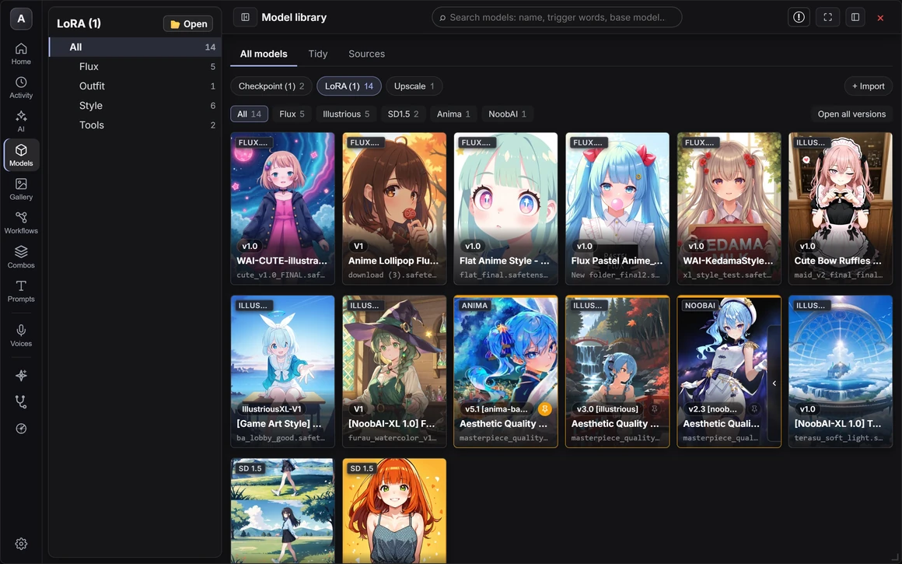

</div>

---

<h2 id="english">🇬🇧 English</h2>

> **Anomalous Model Browser** takes care of the chores around ComfyUI in one window: browse your models by their Civitai covers and trigger words, recover workflows from past outputs, keep tuned workflows with visual presets, snapshot canvas saves to compare fairly and jump back to, reuse model + LoRA combos and tag-based prompts, find missing models again (for sure when the workflow carries this plugin's fingerprints), let an AI app run and refine workflows on a copy tab while you steer each step, and—with the optional companion pack [Anomalous_TTS](https://github.com/DemonGatanjieu/Anomalous_TTS)—give your characters a voice. Everything the plugin changes is recorded in **Activity** with **Undo**.

### 🧭 The idea

**Not another WebUI, not a replacement for ComfyUI: just ComfyUI made easier to use.**

- **Fewer needless chores.** Telling cryptic model filenames apart, fixing red missing-model nodes, digging out how an old picture was made, rewiring the same Checkpoint + LoRAs every session: the plugin handles these.
- **Still your ComfyUI.** The canvas and nodes are ComfyUI's own. The plugin adds **zero custom nodes**: what it places on the canvas are standard ComfyUI nodes (or packs you already installed), so the PNGs and workflows you save open cleanly even on a computer without this plugin.
- **A grounded way to use AI with ComfyUI.** You say what you want in plain words; **Anomalous** opens your workflows and wires tested node blocks on a **copy tab**; **your own ComfyUI and local models** draw the pictures. You see every step, pick which preview continues, and undo any canvas change in one click.

### ✨ Highlights in v1.63

- **AI Workbench — staged creation instead of blind node-guessing**: run fast first-pass base previews and pick your favorite before spending time on a second-pass upscale, inspect results with a before/after slider, snap in tested **Ways** & model-aware **Skills**, and keep your open tab untouched via **AI edits a copy**.
- **Workflows — structure flow diagram, orange preset diffs & Official examples**: every workflow card now draws its stages, models and LoRAs as a compact structure diagram; pick a preset and what it changes lights up in **orange**, or start immediately on a fresh install with **Official examples**.
- **Canvas Saves & locked-seed comparison**: save states of a workflow as `1 · 2 · 3` on a bar under the canvas, batch-run them with **Locked** or **Random** seeds, compare exact node/value diffs beside each save's pictures, and click a save number to restore both the graph and that save's output node previews.
- **Grouped multi-version model cards & numbered multi-LoRA insertion**: files from the same Civitai model page fold into one card (slide out versions under an orange bar, pin your default, or download other Civitai versions); **Insert LoRA** chains several LoRAs in numbered `1 · 2 · 3` order in one `Ctrl+Z` step; the docked sidebar edge drags smoothly from `480px` wide.

### 🎬 Videos and discussion
* 📺 **Bilibili** (Chinese): [Feature demo](https://www.bilibili.com/video/BV1boHx61Enc/) · [Character voices demo](https://www.bilibili.com/video/BV1bkpZ6uEZQ/)
* 💬 **Reddit**: [Discussion on r/comfyui](https://www.reddit.com/r/comfyui/s/n38ihf3DLf)

---

### ✨ AI Workbench: You direct in plain words, ComfyUI draws with your models

Most "AI + image" tools either hide ComfyUI behind a cloud generator or ask an LLM to guess raw node connections from scratch—often breaking your open workflow. **AI Workbench** takes a practical middle route built around your own ComfyUI library:

- **Your open workflow stays safe.** By default (**AI edits a copy**), the first canvas action duplicates your workflow into a dedicated task tab. Your own tab is never touched, and every step on the timeline has **Undo** and **Find on canvas**.
- **Tested building blocks instead of guesswork.** Rather than inventing fragile graphs, the AI opens **your saved workflows**, **any gallery picture's embedded workflow**, or **Official examples**, and extends them with **Ways** tested here (two-pass Tile upscale, mid-way model switch, crop-and-stitch or LanPaint area repaint, hand repair, background swap, pose/depth control…) plus on-demand **Skills** (such as matching pose complexity to your model's parameter scale, or planning multi-stage passes). You can also click **Use it this time** on any Way to lock the AI to your preferred method.
- **Steer before committing GPU time.** On multi-pass workflows, the AI can run a few fast first-pass **base previews** first; **Pick a base** opens on the right-hand **Stage**, you click **Take this one**, and the second pass sharpens that exact image without redrawing the base. Finished runs appear with a **before/after comparison slider**, **Turned out well / Not quite** feedback buttons, and a `✎` brush tool to mark regions for local repainting.
- **Clear boundaries (`Gates`).** You decide what the AI may **Go ahead** with, must **Ask me first** about, or may **Never** do: changing the canvas, using the GPU, downloading models, scanning models online, moving model files. Two more settings cover nodes it places by itself: any custom node pack or only those of the Ways, and whether an untried route of its own waits for your OK (with an optional per-task `🔒` privacy switch when you want prompt text and pictures kept local as `[P1]` / `[img1]` tokens instead of sent to the AI). Works locally with Claude, Cursor, Antigravity, Cherry Studio, VS Code and other MCP-capable apps—copy one sentence from **Connect an AI** to set it up, or see [docs/guides/mcp.md](docs/guides/mcp.md).

<p align="center">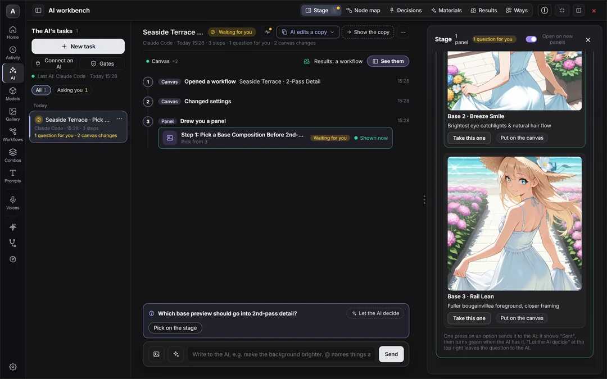</p>

---

### 💡 Everyday ComfyUI chores it solves (with or without AI)

**1. "Which LoRA was `download (3).safetensors` again?"**  
Press **Scan** once: every model is matched on Civitai by its SHA-256 file hash and gets its real title, cover, trigger words and base model badge. Multiple versions of the same Civitai model fold neatly into one card—click its numbered side tab to slide all versions out under an orange bar, pin the version you use most, or check and download other versions from Civitai.

<p align="center">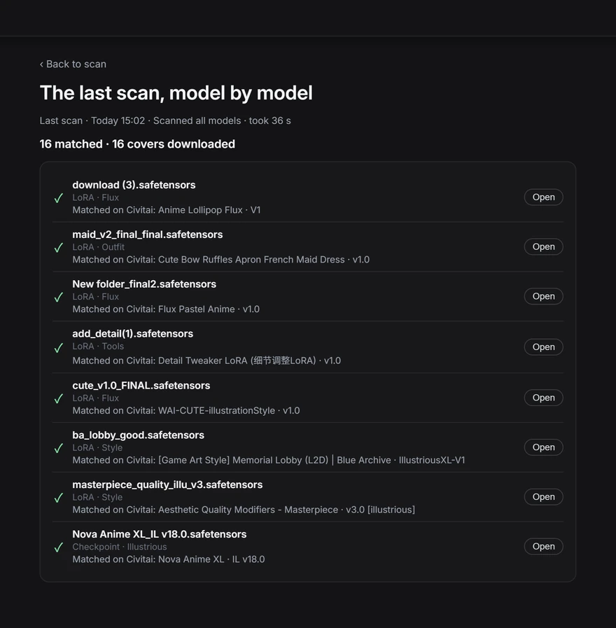</p>

**2. Someone else's workflow opens with red missing-model nodes.**  
**Model Check** looks as soon as a workflow opens, without changing it. How far it gets depends on what the workflow carries:
- **With fingerprints** (its author has this plugin too, which records each model's SHA-256 in the workflows and pictures it saves, unless turned off): the same file on your computer under another name or in another folder is found for certain and goes back in with one press of **Put in**; a model you really lack is looked up on Civitai by its fingerprint and checked against it after downloading.
- **Without fingerprints** (its author does not have this plugin): nothing proves which file it was, so only names are left. A file of the same name in another folder is offered for you to confirm, row by row; VAEs, text encoders and other parts that often share a name are never guessed by name.
- **Downloads** also use the links a workflow carries (ComfyUI's own templates have them) and ComfyUI-Manager's model list. A file that only has the same name is marked **Download by name** and comes only when you press it.

<p align="center"><a href="docs/guides/model-check-rules.en.md"></a></p>

<p align="center">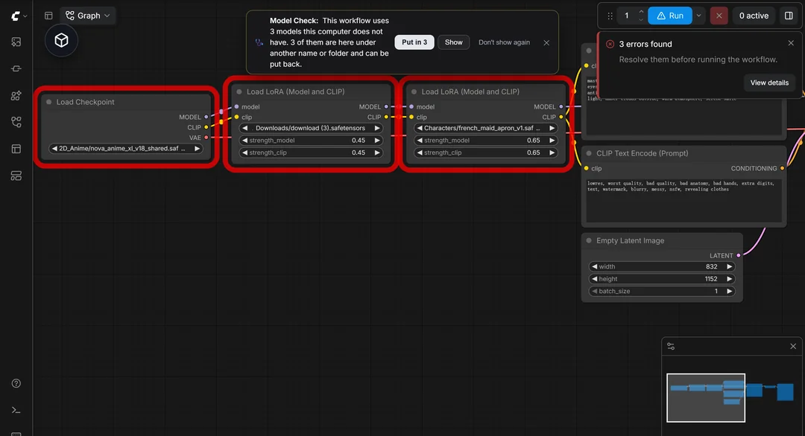</p>

**3. Keep tuned workflows, see their stages at a glance, and switch presets.**  
**Official examples** (text-to-image, two-pass upscale, img2img, inpaint) open ready to run on a model you already own. On any saved workflow card, a compact **structure flow diagram** maps out models, LoRAs and control bars across each sampling stage (`① Base picture` → `② Enlarge and redraw`). Click a **preset tab** and every stage or LoRA it changes turns **orange**; click any box in the flow to see `default → preset` parameter diffs right underneath, apply it to the canvas, or export a `.zip` recipe package / short `⇅` share code.

<p align="center">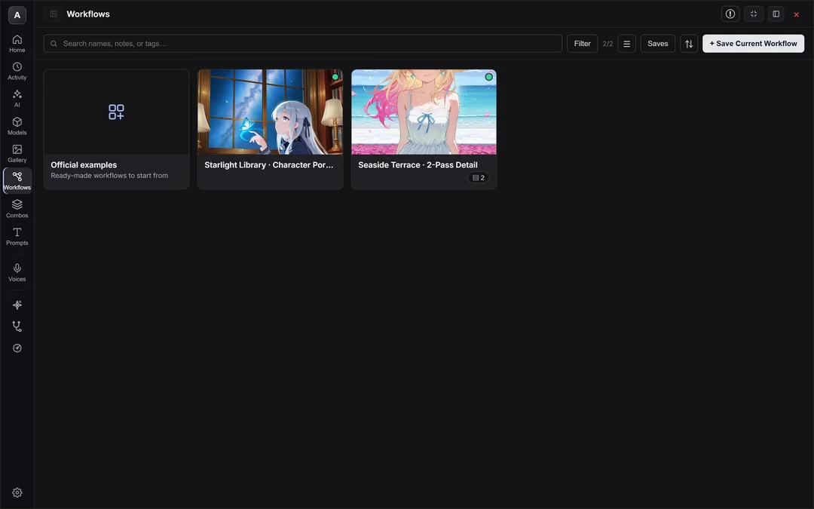</p>

**4. Try another idea without losing this one — Canvas Saves.**  
Right-click the canvas → **Save this state** snapshots the whole workflow onto a compact bar under the canvas; tweak anything and press `+` to save again. Run every save in batch with **Random** or **Locked** seeds for a fair side-by-side test. **Saves** (at the top of Workflows) lists what each save changed beside the pictures it made; click `1`, `2` or `3` on the bottom bar to jump back on the same tab—bringing that save's output node previews back too (`Ctrl+Z` returns; **Keep as a workflow** turns a favorite into a workflow card).

<p align="center">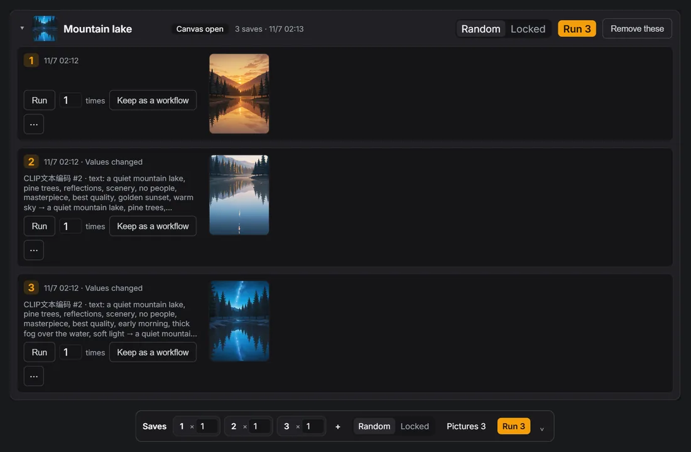</p>

**5. "How did I make this picture?"**  
Search your `output` folder by prompt words, checkpoint, LoRA, seed or model hash (even hundred-megapixel upscales stay smooth via background thumbnails), then drag the picture straight onto the canvas to bring its full workflow back.

<p align="center">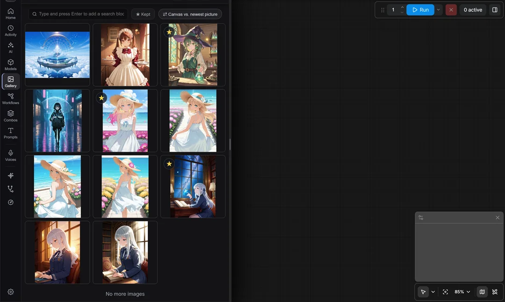</p>

**6. Stop rewiring the same Checkpoint, LoRAs and prompt.**  
Select those nodes on the canvas, right-click → **AMB** → **Save as combo**, and keep them as a card beside the canvas. Press **Put on canvas** (or drag the card) to lay out the wired node group wherever you click without altering existing nodes. Need several LoRAs on an existing loader? **Current node → Insert LoRA** lets you click multiple LoRA cards in `1 · 2 · 3` order and wires the whole chain (or an rgthree / Easy-Use LoRA stack) in one `Ctrl+Z` step.

<p align="center">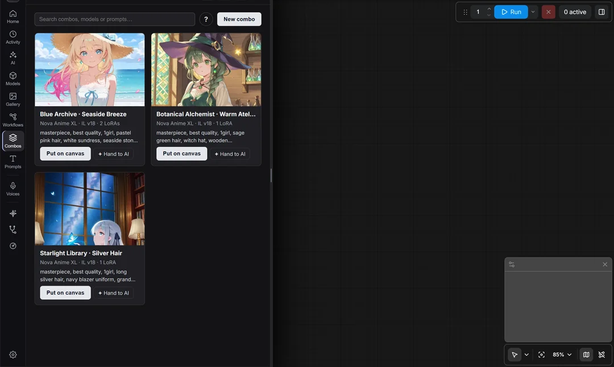</p>

**7. Edit long prompts as clickable tags — Prompt Studio.**  
Dock **Prompt Studio** beside the canvas, select a prompt node, and edit its positive and negative text live as tag pills: click `+` / `−` to adjust weights, double-click to edit, drag to reorder, type in Chinese, Japanese or other languages to insert English tags automatically, and drag saved prompt cards straight onto canvas prompt boxes.

<p align="center">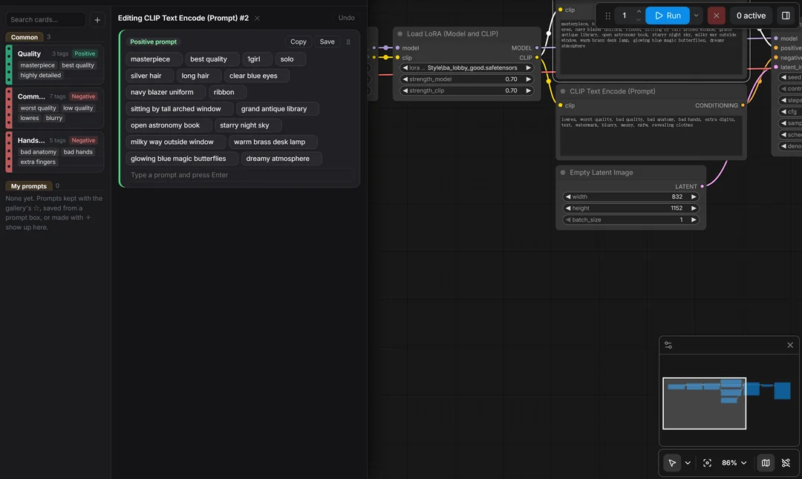</p>

**8. Characters that talk.**  
With the optional companion node pack [Anomalous_TTS](https://github.com/DemonGatanjieu/Anomalous_TTS): manage GPT-SoVITS characters with a reference clip per emotion, fix pronunciations, and generate dialogue lines from a script page.

<p align="center">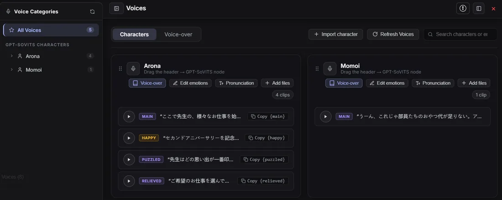</p>

**Changed your mind?**  
Every change made by Anomalous or an AI task is logged in **Activity** with before → after values, **Find on canvas** and one-click **Undo**.

<p align="center">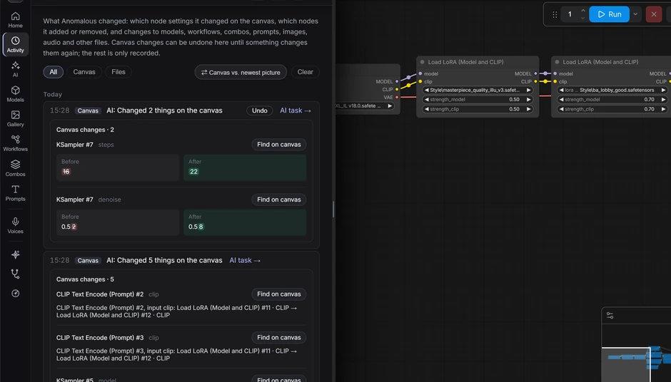</p>

**Light on your computer**: the plugin itself loads no AI models and takes **zero VRAM** away from image generation; grids use cached thumbnails rather than full originals, and browser image memory is released 90 seconds after closing the window. Voice models in `Anomalous_TTS` yield VRAM automatically whenever ComfyUI generates images, or completely on **Unload models**.

### 📦 Install

1. In **ComfyUI Manager**, search `Anomalous Model Browser`, install it and restart ComfyUI. Or clone it into `custom_nodes`:
   ```bash
   cd custom_nodes
   git clone https://github.com/DemonGatanjieu/Anomalous_Model_Browser.git
   ```
2. Press **Shift + B** to open it. On **Home**, **Scan model folders** fetches covers and trigger words, and **Tour the interface** walks through each area of the window.
3. Optional: for character voices, install [Anomalous_TTS](https://github.com/DemonGatanjieu/Anomalous_TTS) (`Anomalous TTS` in ComfyUI Manager). Nothing else depends on it.

Scanning reaches Civitai by file hash (no extra Python dependencies). Without internet access, choose **Offline** scan: base models are read directly from file headers, and a later online scan fills in covers and trigger words (see **Network and backups** below).

<details>
<summary><b>📖 Every page and tool, in detail</b></summary>

Every page has an icon on the left rail; when docked beside the canvas, drag the window's right edge (`480px` minimum, double-click to reset to `660px`) to resize.

| Page | What you do there |
| :--- | :--- |
| **🏠 Home** | Task cards for common jobs, first-run steps (**Scan model folders**, **Tour the interface**), recent AI tasks and latest activity. |
| **🕘 Activity** | Everything Anomalous changed, grouped by day: canvas edits (before → after node values, added/removed nodes, opened workflows, links to AI tasks) and file operations (models, covers, workflows, combos, prompts, images, audio). **Find on canvas** jumps straight to the node; canvas changes offer **Undo** while still current. Your manual canvas edits are not listed. |
| **📦 Models** | Browse models with Civitai covers, trigger words and base model chips. Switch types at the top (Checkpoint, LoRA, VAE…) or narrow to a subfolder on the left; **+** drops a loader node onto the canvas. Files sharing a Civitai model ID fold into one card with a numbered side arrow (slide out under an orange bar, pin a default version, or use **Open all versions**); model details also fetch **All versions on Civitai** for SHA-256-checked downloads. Includes **Tidy** (spot misplaced or duplicate files) and **Sources**. |
| **🖼️ Gallery** | Your ComfyUI `output` folder (including background-rendered previews for ultra-large upscales). Search by prompt, model, LoRA, seed, filename or model hash; inspect full generation parameters, compare two images, drag onto the canvas to restore the workflow, or click **☆** to keep as a workflow, combo or saved prompt. |
| **✨ AI workbench** | Task-by-task workspace for MCP AI apps: live step timeline with **Undo**, copy-tab controls (**AI edits a copy** / **Show the copy**), **Stage** panels (first-pass base picks, before/after comparison slider, choices, `✎` brush repaint markup, **Turned out well / Not quite**), **Node map**, **Decisions**, **Materials**, **Results**, **Ways** (with **Use it this time**) & **Skills**, and **Gates** (including optional per-task `🔒` privacy mode). Follow-up tasks indent cleanly under their parent task. |
| **🪡 Workflows** | **Official examples** and **Saves** at the top, followed by saved workflow cards. Details show a compact **structure flow diagram**, sticky **preset tabs** (highlighting changed stages in orange, with inline node diffs and **+ New preset**), **Hand to AI**, version comparison/restore, `.zip` **recipe packages**, and `⇅` share codes / drag-and-drop import. |
| **🧩 Combos** | Keep a main model, several LoRAs (with exact strengths) and prompts together as one card. **Put on canvas** (or dragging the card) places them as a newly wired node group without touching existing canvas nodes. |
| **✍️ Prompts** | Prompt Studio—full page or docked **Beside the canvas**. Edits selected prompt nodes live as tags: click to weight, double-click to edit, drag to reorder, type in Chinese/Japanese/etc. to translate into English tags, display per-tag translations underneath, or drag prompt cards onto positive (green) / negative (red) boxes. Works as a scratchpad when no prompt node is selected. |
| **🎙️ Voices / 🎧 Audio** | With [Anomalous_TTS](https://github.com/DemonGatanjieu/Anomalous_TTS): import GPT-SoVITS characters, assign reference clips per emotion, tune pronunciations, write multi-line scripts under Voice-over, and browse generated clips in the audio gallery. |

Tools at the bottom of the rail (ordered by frequency of use):

* **Current node** (formerly Node Assistant): inspects the selected canvas node's model, swaps models from visual cards, inserts one or **multiple numbered LoRAs** at once (as standard chained nodes or into an rgthree Power Lora Loader / Easy-Use stack), and compares/applies saved values from workflows, combos, gallery pictures or node presets (`⇄ Compare` checks that node alone).
* **Model Check** (formerly Model Doctor): checks opened workflows read-only; offers a one-click banner when renamed or moved local files match the workflow's SHA-256 fingerprints (written by this plugin: **Settings → Record model fingerprints in workflows**, on by default); without fingerprints, offers a file of the same name for you to confirm. Downloads come from Civitai by fingerprint, the workflow's own links or ComfyUI-Manager's model list. [The full rules](docs/guides/model-check-rules.en.md).
* **Scan**: hashes model files locally, reads headers (including offline base-model & architecture detection checked against 300+ model layouts), and fetches Civitai covers, names and trigger words.
* **Settings**: language (switches live across all panels, Stage and Saves bar), interface scale, theme, thumbnails, video covers, model download mirrors, backups, and **Report a problem** (pre-filled with version & GPU info).

**Connecting AI apps (MCP)**: Claude, Cursor, Antigravity, Cherry Studio, VS Code and other MCP clients connect locally via `http://127.0.0.1:8188/anomalous/mcp` (localhost only). Full setup and tool reference in [docs/guides/mcp.md](docs/guides/mcp.md).

</details>

<details>
<summary><b>⚙️ Opening, shortcuts and updating</b></summary>

Open the browser with **Shift + B** (press again to close), the floating canvas button, or **Extensions → Anomalous Model Browser** in ComfyUI's menu. Customize the shortcut, language and launcher style under **ComfyUI Settings → Anomalous Model Browser → Interface**.

**Updating**: click the **!** button at the top right of the browser, then **Check for updates / switch version** to update to the newest release or roll back to an earlier tag, and restart ComfyUI. The plugin never phones home or checks for updates in the background.

</details>

<details>
<summary><b>🌐 Network and backups</b></summary>

**On a cloud server (AutoDL, RunPod…):** overseas servers work out of the box; servers in mainland China only in part (Civitai is mostly out of reach there; see the `civitai.red` fallback and `hf-mirror.com` below). Tested on one AutoDL server so far. Opened from another machine, the plugin defaults to read-only for safety; connect via an SSH tunnel so ComfyUI sees `127.0.0.1`, or read [docs/guides/cloud-server.md](docs/guides/cloud-server.md).

**Network:** Civitai scanning and Google prompt translation require network access (when `civitai.com` is unreachable, the plugin tries `civitai.red` automatically; **Offline** scan works without internet and reads base models from file headers). For Hugging Face downloads in mainland China, enable **Settings → Model downloads → Hugging Face mirror (`hf-mirror.com`)**. Daily browsing of models, gallery, workflows, saves and combos requires **no network**.

**Backups:** **Settings → Backup → Export** packs your saved workflows, presets, canvas saves, combos, prompts, node values, and custom model names/notes/covers into a single `.zip` for cloud drives or a move to another PC. **Import** never deletes anything: a file that differs from the backup's stays unless you choose to take the backup's (yours then goes to the Recycle Bin). A backup also lists your models with their fingerprints, so on a new computer the missing ones can be looked up and downloaded again. Data lives under `workflows/anomalous_*` inside your ComfyUI `user` folder.

</details>

---

<h2 id="中文">🇨🇳 中文说明</h2>

> **Anomalous Model Browser** 在一个窗口里帮你打理 ComfyUI 周边的琐事：
> - 带 C 站封面、触发词和多版本折叠卡浏览模型；
> - 翻看历史出图，一拖还原当时的完整工作流；
> - 用结构流程图和预设管理调好的工作流，随时给画布存几个存档锁种对比、一键回退；
> - 存下常用的模型 + LoRA 搭配，用词块直观编辑长提示词；
> - 打开别人的工作流缺模型时帮你找回或下载（工作流带着本插件记的指纹时最准）；
> - 在 **AI 工作台** 里动嘴提要求，让 AI 在副本标签页里调用你的工作流和实测“做法”跑图、先挑底图再放大精修；
> - 配合可选节点包 [Anomalous_TTS](https://github.com/DemonGatanjieu/Anomalous_TTS) 给角色配音。
>
> 插件和 AI 改动过的每一处画布设置，都在“记录”里写得明明白白，随时定位或撤销。

<p align="center">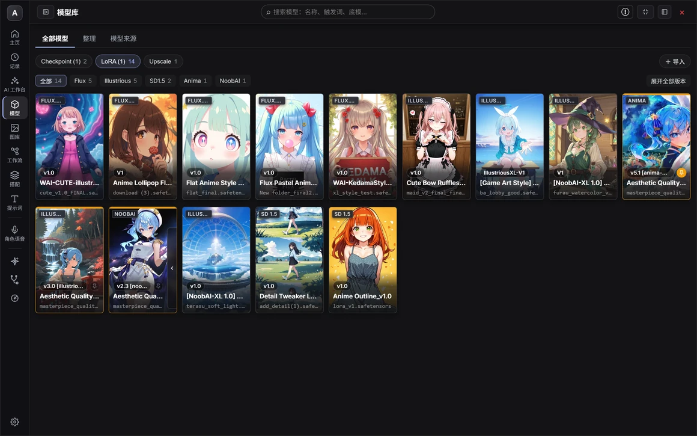</p>

### 🧭 理念

**不再造一个套壳 WebUI，也不取代 ComfyUI，只是把 ComfyUI 身边最磨人的杂活接过去。**

- **少做没必要的体力活。** 认乱码文件名、修一片红框的缺模型节点、翻旧图找参数、每次重连同一串大模型和 LoRA——这些交给插件做。
- **用的还是你自己的 ComfyUI。** 画布和节点全是 ComfyUI 原生的。插件本身**一个自定义节点都不往工作流里塞**，放到画布上的都是官方节点或你本来就装了的节点包；出的图、另存的工作流，发给没装本插件的朋友照样直接打开。
- **接 AI 也不走“黑盒盲猜”路线。** 你只管用人话提要求；**AMB** 负责在**副本标签页**里打开你的工作流、接好实测过的节点块；真正出图的还是**你本机的 ComfyUI 和你挑的模型**。每一步改了什么都在眼前，先挑构图再跑慢速放大，不满意随时一步撤销。

### ✨ 1.63 重点更新

- **AI 工作台走通“分阶段导演式出图”**：多段流程支持**先快速跑几张一阶段底图让你挑**（点“就选这张”锁种进入二段放大，不重画底图），右侧展台提供**前后拉帘对比**、局部涂抹重绘与“效果好 / 不太行”一键反馈；内置按用途整理的实测**做法**与按需 **Skill**，默认在**副本标签页**干活，不碰你正在改的画布。
- **工作流详情升级“结构流程图 + 橙色预设差异 + 官方示例”**：点开工作流就能看到按出图阶段排布的结构图（底模、LoRA、控制模型横跨在它们作用的阶段上方）；切换**预设**时改动过的阶段直接标成**橙色**，点格子即看 `默认 → 当前预设` 参数对比；顶部新增**官方示例**，新装环境打开就能跑。
- **画布存档与锁种公平对比**：右键画布存下当前状态，底部存档条随时切回 `1 · 2 · 3`（连输出节点上的预览图也跟着一起切回对应存档！），支持**锁种**或**随机**批量跑多组存档，并在存档页并排对比每版改了什么和各自出的图。
- **同模型多版本合卡 & 一次按顺序插入多个 LoRA**：来自同一个 C 站模型页的多个版本自动收成一张卡（点右侧数字展开橙边抽屉、图钉设默认版本、按 SHA-256 下载该模型其他版本）；**插入 LoRA** 支持点选多个按 `1 · 2 · 3` 编号自动串好线（或放进 rgthree / Easy-Use 堆叠节点），一次 `Ctrl+Z` 全退回；侧边停靠支持拖拽右边缘自由调宽（最窄 `480px`）。

### 🎬 视频与讨论
* 📺 **哔哩哔哩 (Bilibili)**：[功能演示](https://www.bilibili.com/video/BV1boHx61Enc/) · [角色配音演示](https://www.bilibili.com/video/BV1bkpZ6uEZQ/)
* 💬 **Reddit**：[r/comfyui 上的介绍帖](https://www.reddit.com/r/comfyui/s/n38ihf3DLf)

---

### ✨ AI 工作台：你用人话当导演，AMB 搭线，ComfyUI 用你的模型出图

很多人一听“在 ComfyUI 里接 AI”，第一反应往往是两个顾虑：要么怕它像云端生图软件一样绕开自己的本地模型库，要么怕大模型瞎猜节点连线，把自己辛辛苦苦调好的画布搅得一团糟。**AI 工作台**走的是另一条路——**让 AI 当你的操作助手，规矩由 AMB 守住**：

- **默认只改“副本”，绝不弄乱你开着的画布。** 任务默认开启 **AI 改副本**：AI 第一次动手前，AMB 自动把工作流复制到专属的任务标签页里操作，你原来的标签页一笔不动；时间线上的每一步都能点 **撤销** 或 **在画布上找到**。
- **不靠瞎猜连线，优先用你的工作流和实测“做法”。** AI 会直接调用**你存好的工作流及预设**、**图库某张图自带的工作流**，或是开箱即用的 **官方示例**；需要加功能时，由 AMB 按你已装的节点包搭上实测过的 **做法**（Tile 锁图二段放大、半途换模型接着画、裁切缝合 / LanPaint 局部重绘、修手先放大再修、换背景、姿势/深度控制……），并配合按需 **Skill**（按主模型参数量给动作建议、分阶段出图思路）。你还能在做法面板点 **这次用它**，直接指定本次任务必须走哪套做法。
- **先挑快底图，再跑慢精修，展台拉帘对比。** 跑两段放大这类耗时流程时，AI 可以先快速跑几张第一段底图预览（不污染正式输出目录）；右侧**展台**弹出挑选面板，你点 **就选这张**，第二段直接接着这张图做细节重绘，省掉重跑底图的时间。出图后展台提供**前后拉帘对比**、**效果好 / 不太行** 按钮，哪里不满意还能点图片右上角 `✎` 用画笔涂出区域让它只重画那一块。
- **权限全由“关卡”把关。** 改画布、用显卡出图、下载模型、联网扫描模型、挪动模型文件，都能在 **关卡** 里设为“直接做 / 先问我 / 不许做”；AI 自己往画布上加节点时，能不能用任意第三方节点包、没验证过的新路线要不要先问你，也在这里设（任务标题栏还带可选的 `🔒` 隐私开关，开启后提示词与图片名会换成 `[P1]`、`[img1]` 代号，不把原图和原文发给 AI）。支持连接 Antigravity、Claude、Cursor、Cherry Studio、VS Code 等支持 MCP 的本机软件——点工作台里的 **连接 AI** 复制一句话发给它就能配好，详见 [docs/guides/mcp.md](docs/guides/mcp.md)。

<p align="center"></p>

---

### 💡 日常玩 ComfyUI，它帮你省掉哪些麻烦（不接 AI 也一样主力）

**1. 模型塞满硬盘，文件名全是 `download (3).safetensors`。**  
点一次 **扫描**，每个模型按文件 SHA-256 哈希去 C 站认领真名、高清封面、触发词和底模角标。同一个 C 站模型的不同版本还会自动收进一张卡片，点右侧数字滑出全部版本（顶部橙边相连），点图钉设默认版本，详情里还能直接核对下载该模型在 C 站上的其他版本。

<p align="center">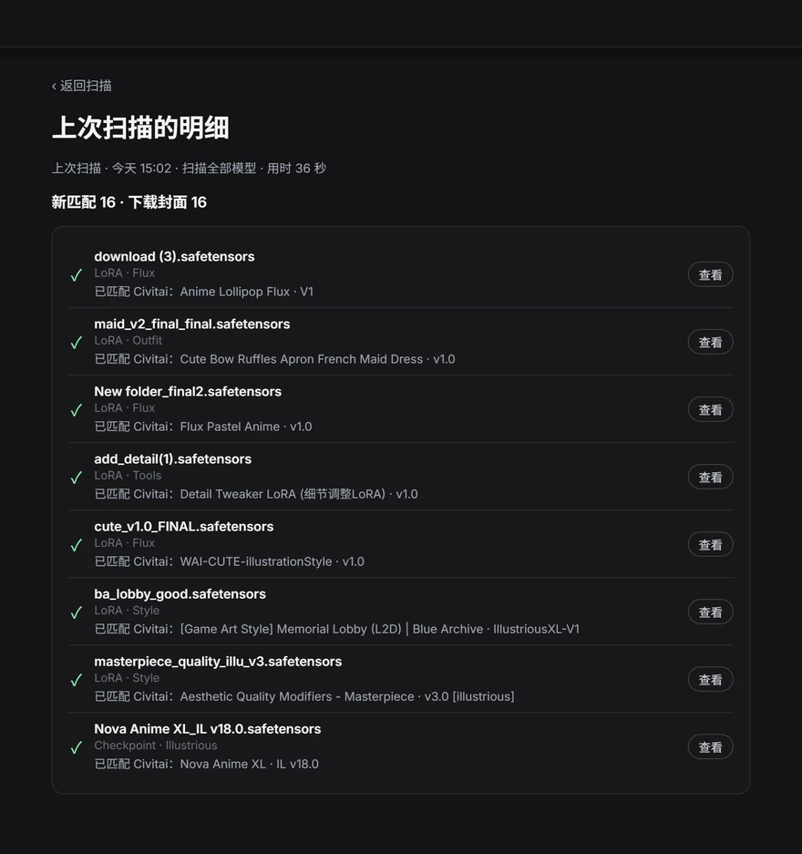</p>

**2. 打开别人分享的工作流，满屏红框缺模型。**  
**模型检查** 在打开工作流时自动只读体检，能做到哪一步，看工作流里带了什么：
- **带指纹的**（作者也装了本插件，出图、存工作流时默认记下每个模型的 SHA-256）：你电脑里其实有、只是改了名或挪了文件夹的同一个文件，能确定认出来，横幅上点一下 **换上** 就全部就位；真缺的按指纹去 C 站找，下载完核对一致才换上。
- **没带指纹的**（作者没装本插件）：没法证明是哪一个文件，只能按名字找。别的文件夹里恰好有一个同名文件，会列出来让你逐个确认；VAE、文本编码器这类经常同名的组件不按名字猜。
- **下载**时还会查工作流自带的下载链接（ComfyUI 官方模板就带着）和 ComfyUI-Manager 的模型清单，Hugging Face 的文件可以走国内镜像。只是名字对上的会标成 **按文件名下载**，你点了才下。

<p align="center"><a href="docs/guides/model-check-rules.md"></a></p>

<p align="center">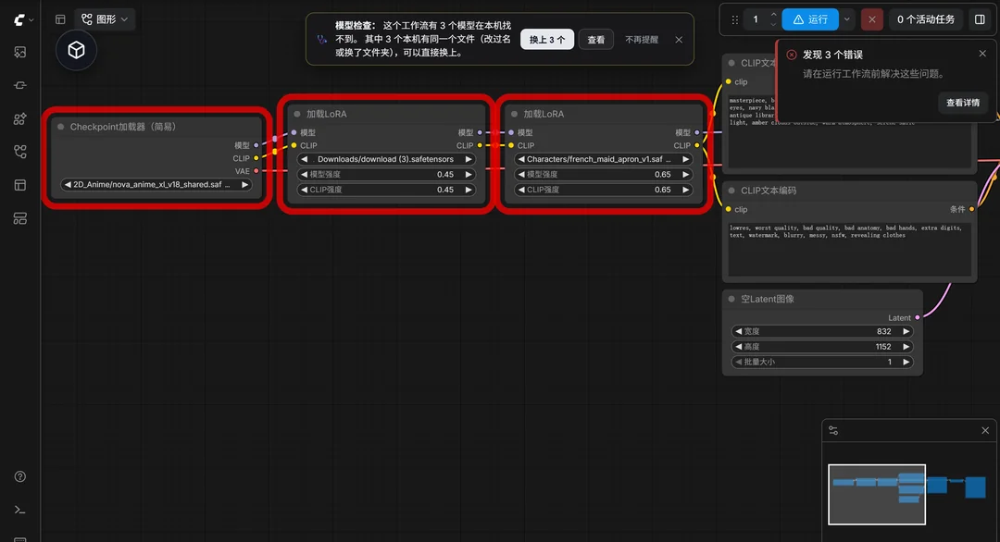</p>

**3. 存下调好的工作流，结构流程图和橙色预设差异一眼看清。**  
顶部自带 **官方示例**（文生图、两段放大、图生图、局部重绘，自动配好你本机已有的模型），新手装上就能出图。存下的每张工作流卡点开就是清爽的 **结构流程图**：底模、LoRA、控制模型横跨在它们管辖的采样阶段（`① 出底图` → `② 放大重画`）上方。切换下方的 **预设标签**，和默认参数不同的阶段直接亮起 **橙色**，点任意方格就能在下方展开 `默认 → 当前预设` 的逐项对比；还能打成 `.zip` **配方包** 或生成短短一截 `⇅` 汉字/字母分享码发给别人。

<p align="center">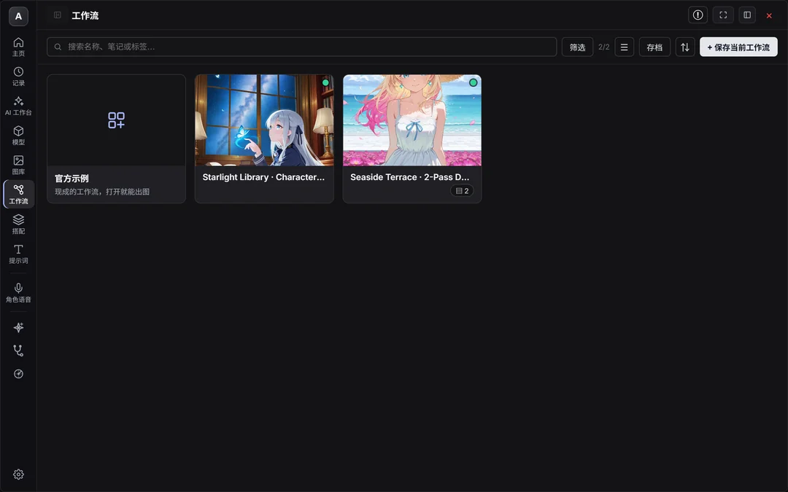</p>

**4. 想试几种新参数或加个 LoRA，又怕改坏现在这版 —— 画布存档。**  
在画布上右键 → **存档当前工作流**，当前状态就存进画布底部的存档条；接着随便改参数、加节点，点 `+` 再存几版。存档条支持选 **锁种**（同一组种子公平对比）或 **随机**，一键把几个存档按顺序排进队列。“工作流”页顶部的 **存档** 把每个存档改了什么和它跑出的图并排摆在一起；点底部存档条的数字 `1`、`2`、`3` 就能在当前标签页秒回那一版——**连输出节点上的预览图也会跟着切回那个存档跑出来的图**（`Ctrl+Z` 可撤回，满意的随时点 **收藏为工作流**）。

<p align="center">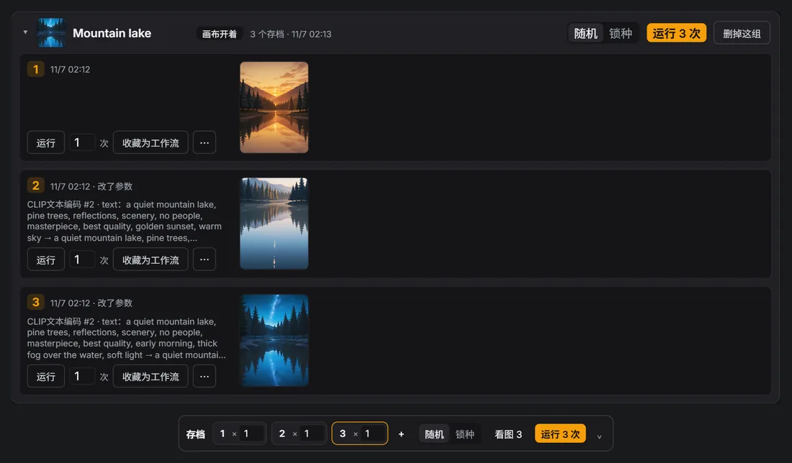</p>

**5. 翻到一张老图：“当时到底怎么调出来的？”**  
在 **图库** 里按提示词、大模型、LoRA、种子或模型哈希秒搜（哪怕几亿像素的超大图也在后台独立进程生成缩略图，绝不卡死页面），把图往画布上一拖，当时的完整工作流直接回来。

<p align="center"></p>

**6. 每次开新图都要重连一遍大模型、LoRA 和起手提示词。**  
框选画布上的这几个节点，右键 → **AMB** → **存为搭配**，就存成一张搭配卡。下次点 **放到画布**（或直接拖卡片），点哪里就在哪里放出一组连好线的节点，画布原有的东西分毫不动。想在已有节点后面加几个 LoRA？到 **当前节点 → 插入 LoRA** 里连点几张卡片，卡片上的数字 `1 · 2 · 3` 就是串联顺序（装了 rgthree 或 Easy-Use 还能一键塞进同一个 LoRA 堆叠节点），一次 `Ctrl+Z` 整串退回。

<p align="center"></p>

**7. 提示词一长串逗号，改权重、调顺序眼都花了 —— 提示词工坊。**  
点 **停到画布旁** 把工坊挂在画布左侧，选中任意提示词节点，正负面文本立刻拆成可视化词块：点 `+` / `−` 调权重，双击改字，拖拽换顺序，直接敲中文回车自动译成英文词块加进去，常用词卡还能直接拖进画布的正向（绿框）/ 反向（红框）输入框里。

<p align="center">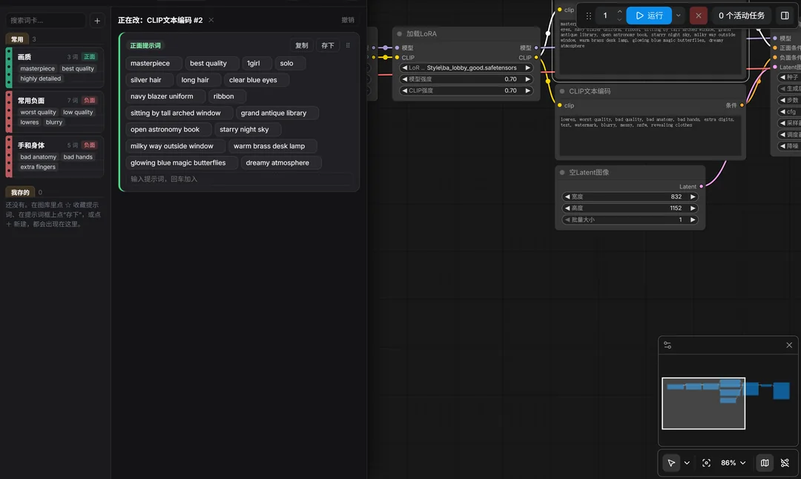</p>

**8. 想让画出来的角色开口说话。**  
配合可选节点包 [Anomalous_TTS](https://github.com/DemonGatanjieu/Anomalous_TTS)：导入 GPT-SoVITS 角色，按情绪绑定参考音频、修正多音字读音，在配音页写好台词直接生成语音。

<p align="center">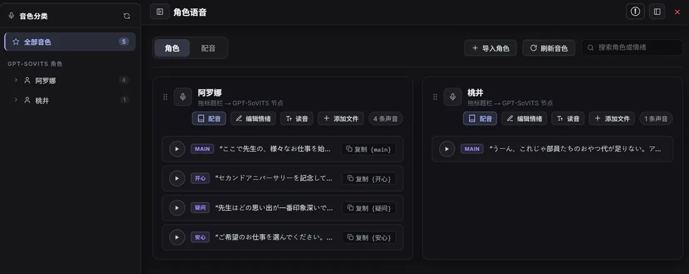</p>

**改错了也不怕。**  
插件和 AI 在画布上改过的每一个参数、连过的每一根线，都按天记在 **记录** 里，展开就能看修改前后的数值，点 **在画布上找到** 直接跳过去，点 **撤销** 一键退回。

<p align="center">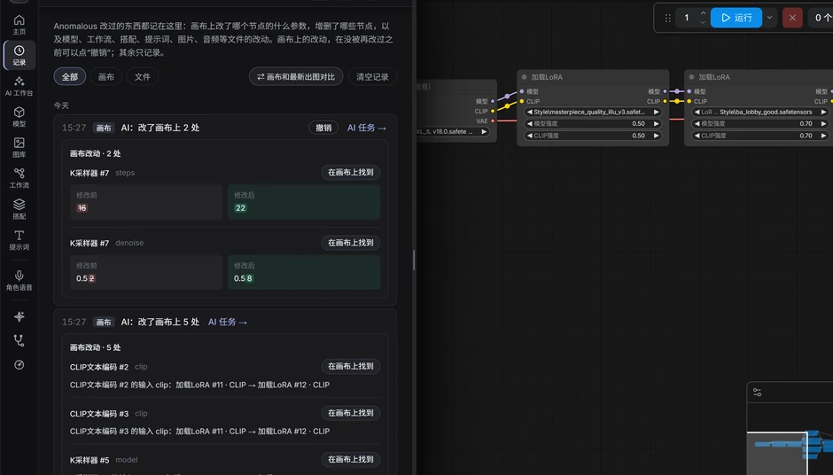</p>

**不抢你的显存和内存**：
- 插件自身不加载任何生图模型，**零显存占用**，绝不和 ComfyUI 出图抢资源。
- 浏览网格全程走小缩略图缓存，不把原图塞进浏览器；关闭窗口一分半后自动释放图片内存。
- `Anomalous_TTS` 的语音模型在 ComfyUI 生图需要显存时会自动让出，点 **卸载模型** 则彻底清空。

### 📦 安装

1. 在 **ComfyUI Manager** 里搜索 `Anomalous Model Browser`，安装后重启 ComfyUI；或在 `custom_nodes` 目录下手动克隆：
   ```bash
   cd custom_nodes
   git clone https://github.com/DemonGatanjieu/Anomalous_Model_Browser.git
   ```
2. 按 **Shift + B** 打开窗口。第一次用可以在 **主页** 点 **扫描模型文件夹** 补齐封面和触发词，点 **界面导览** 跟着认识一圈各个区域。
3. 需要角色配音的话，再安装 [Anomalous_TTS](https://github.com/DemonGatanjieu/Anomalous_TTS)（ComfyUI Manager 搜索 `Anomalous TTS`）；不装完全不影响其他功能。

扫描模型默认联网查 C 站（纯内置实现，无需额外装 Python 包）。没开代理或断网时选 **离线扫描** 也能直接从模型文件头识别底模与架构，等以后连上网再扫一次会自动补齐封面和触发词（详见下方“网络和备份”）。

<details>
<summary><b>📖 每个页面和工具的详细说明</b></summary>

窗口左侧是页面图标栏；切换为“侧边停靠”时，按住窗口右边缘即可左右拖宽窄（最窄 `480px`，双击边缘恢复默认 `660px`）。

| 页面 | 在这里做什么 |
| :--- | :--- |
| **🏠 主页** | 按你想做的事分好入口卡片，包含新手第一步（扫描模型文件夹、界面导览）、AI 最近做的任务和最新操作记录。 |
| **🕘 记录** | 按天列出插件和 AI 做过的全部改动：画布改动（具体哪个节点的什么参数从多少改成多少、增删了哪些节点、关联哪个 AI 任务）与文件操作（模型、封面、工作流、搭配、提示词、图片、音频）。支持 **在画布上找到** 定位节点，没被后续覆盖的画布改动可随时 **撤销**。 |
| **📦 模型** | 带封面、触发词和底模分类条浏览模型，左侧可按子文件夹筛选，点 **+** 一键往画布放加载器。来自同一 C 站模型页的多个版本自动收成一张卡（点右侧数字展开橙边版本排、图钉固定默认显示版本、右上可 **展开全部版本**）；详情页点 **Civitai 上的全部版本** 可按需联网查看并按 SHA-256 核对下载其他版本。另含 **整理**（排查放错目录或重复文件）与 **模型来源**。 |
| **🖼️ 图库** | 读取 ComfyUI 的 `output` 文件夹（几亿像素超大图由后台子进程做缩略图，浏览不卡）。支持按提示词、模型、LoRA、种子、文件名或模型哈希组合搜索；看大图与完整参数、勾选两张对比工作流差异、拖进画布还原工作流，或点 **☆** 存为工作流、搭配、提示词。 |
| **✨ AI 工作台** | 按任务记录并操控接入的 AI：左侧任务树（后续任务自动缩进挂在主任务下），中间实时步骤时间线（每步可撤销，顶部带 **AI 改副本** 与 **切到副本**），右侧可切换 **展台**（一阶段底图挑选、前后拉帘滑块、选择题、`✎` 涂抹局部重绘、**效果好 / 不太行**）、**节点结构**、**决策**、**素材**、**成果**、**做法**（支持点“这次用它”）与 **Skill**，以及权限 **关卡**（含可选单任务 `🔒` 隐私开关）。 |
| **🪡 工作流** | 顶部是 **官方示例** 与 **存档**，下方是保存的工作流卡。详情页从上到下依次为 **结构流程图**、吸顶 **预设标签栏**（橙色标出与默认不同的阶段，点方格看逐项差异，支持 **+ 新预设**）、**交给 AI**、历史版本对比恢复，支持导出 `.zip` **配方包** 或通过 `⇅` 收发短分享码、拖入图片/压缩包导入。 |
| **🧩 搭配** | 把顺手的主模型、几个 LoRA（连同各自权重）和正反提示词存成一张搭配卡。点 **放到画布** 或拖入画布即生成连好线的独立节点组，绝不改动画布上原有的节点。 |
| **✍️ 提示词** | 提示词工坊，可全窗口用，也可点 **停到画布旁** 边看节点边改。选中提示词节点后自动拆成词块：单击调权重、双击改字、拖拽排顺序、输入中文/日文回车自动译成英文词块，还能在词块下显示多语种释义；左侧词卡支持一键加入或拖进画布正/反向输入框，未选节点时可当草稿本写。 |
| **🎙️ 角色语音 / 🎧 音频库** | 安装 [Anomalous_TTS](https://github.com/DemonGatanjieu/Anomalous_TTS) 后启用：导入 GPT-SoVITS 角色、按情绪选参考音频、修读音，在“配音”页写台词直接生成，并在音频库回放管理。 |

左侧栏底部的常用工具（按日常使用频率从上到下排列）：

* **当前节点**（原“节点助手”）：跟随画布当前选中的节点，看封面换模型，或点 **插入 LoRA** 一次勾选多个 LoRA 按 `1 · 2 · 3` 顺序自动串接（装了 rgthree / Easy-Use 可选塞入单个堆叠节点）；下方按来源小标签（工作流、搭配、图片、本节点存的）列出同类节点参数，点 `⇄ 对比` 只看当前节点差异并一键套用。
* **模型检查**（原“模型医生”）：打开工作流自动只读检查；本机改过名或换过目录的同一文件凭 SHA-256 指纹在画布顶部横幅一键换上（指纹由本插件写进工作流：**设置 → 在工作流里记下模型指纹**，默认开启）；没有指纹时列出同名文件让你确认。缺的模型从 C 站（按指纹）、工作流自带的链接或 Manager 清单下载。[完整规则](docs/guides/model-check-rules.md)。
* **模型扫描**：按文件哈希向 C 站匹配模型信息与封面；离线时也已针对 Manager 清单 300+ 真实模型文件头校准过底模与类型识别，不乱下误判结论。
* **设置**（最下方）：中英文实时切换（工作台展台、留言框与底部存档条立即生效，无需刷新页面）、界面缩放、深浅主题、缩略图与视频封面、Hugging Face 国内镜像、数据备份导出/导入，以及自动附带版本与显卡信息的 **报告问题**。

**接入 AI 软件（MCP）**：Antigravity、Claude、Cursor、Cherry Studio、VS Code 等支持 MCP 的客户端可通过本机地址 `http://127.0.0.1:8188/anomalous/mcp` 连接（仅接受本机请求）。完整配置与工具清单见 [docs/guides/mcp.md](docs/guides/mcp.md)。

</details>

<details>
<summary><b>⚙️ 打开方式、快捷键和更新</b></summary>

打开方式有三种：按 **Shift + B**（再按一次关闭）、点击画布悬浮按钮，或从 ComfyUI 菜单 **扩展 → Anomalous Model Browser** 进入。在 **ComfyUI 设置 → Anomalous Model Browser → 界面** 中可自定义快捷键、语言及入口按钮样式。

**更新与版本切换**：点击窗口右上角的 **!** → **检查更新 / 切换版本**，可一键升级到最新正式版或回退到历史版本，完成后重启 ComfyUI 生效。插件绝不会在后台悄悄联网检查更新。

</details>

<details>
<summary><b>🌐 网络和备份</b></summary>

**云服务器（AutoDL、RunPod 等）：** 海外云服务器完整支持；国内云服务器只能部分支持：多半连不上 Civitai，有的能连上 `civitai.red` 认出模型名与触发词（封面较难下载）。目前只实测过一台 AutoDL 服务器。从非本机浏览器直接访问时插件默认只读保护，建议通过 SSH 隧道映射到本地打开，详见 [docs/guides/cloud-server.md](docs/guides/cloud-server.md)（内附可直接丢给 AI 助手照着配的步骤）。

**关于网络：** 扫描封面与谷歌提示词翻译需要联网（连不上 `civitai.com` 时会自动尝试 `civitai.red`；无代理时选 **离线** 扫描同样能识别底模）。下载 Hugging Face 模型可在 **设置 → 模型下载** 开启 `hf-mirror.com` 国内镜像。日常浏览模型、图库、工作流、存档和搭配**完全不需要联网**。

**备份自己的数据：** **设置 → 备份 → 导出** 会把工作流、预设、画布存档、搭配、提示词库、节点参数以及你自定义的模型名/备注/封面打包成一个 `.zip`，换电脑或重装后点 **导入** 即可恢复。导入从不删东西：和备份里不一样的文件默认留着你电脑上的，选了“换成备份里的”才替换，原来的进回收站。备份里还记着你有哪些模型和它们的指纹，换了新电脑，缺的模型可以照着清单查来源补下载。（数据保存在 ComfyUI 用户目录下的 `workflows/anomalous_*` 文件夹中。）

</details>

---

### 🧪 Tests (测试)

The plugin's tests live in `tests/`; run the full suite with `node tools/run_tests.mjs` from the plugin folder. See [docs/guides/testing.md](docs/guides/testing.md).  
插件测试位于 `tests/` 目录，在插件根目录运行 `node tools/run_tests.mjs` 即可一次跑完。提 PR 或改代码前请先跑通，详见 [docs/guides/testing.md](docs/guides/testing.md)。

### 📝 License & Branding (开源与品牌声明)

* **Code License (代码授权)**: The source code is released under the [MIT License](LICENSE). 本项目源代码基于 MIT 许可证开源，可自由使用、修改与分发。
* **Branding & Trademarks (商标与品牌保护)**: The name **Anomalous Model Browser** and the official logo identify official releases. Forks should use distinct names/branding. 详见 [Trademark and Brand Policy](TRADEMARKS.md)。
